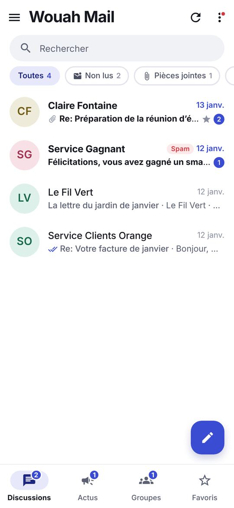
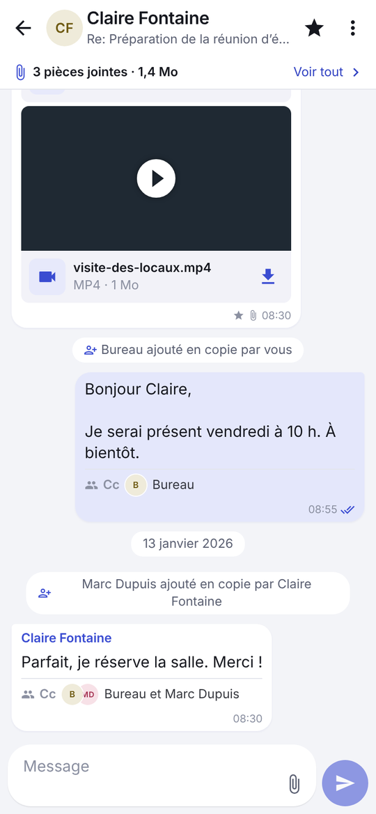
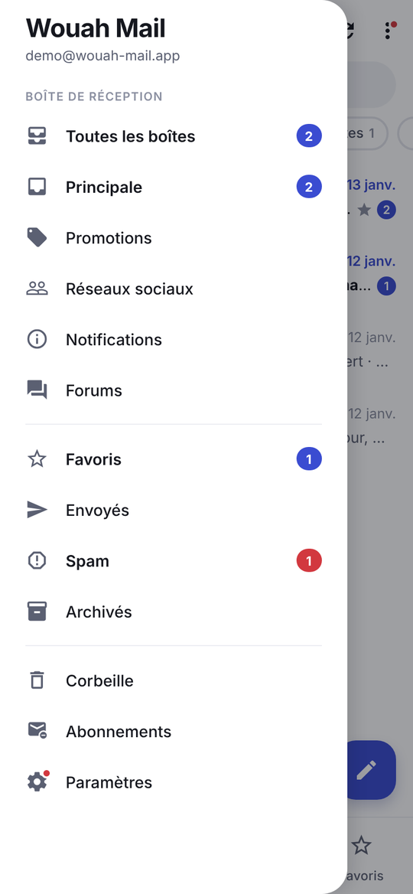
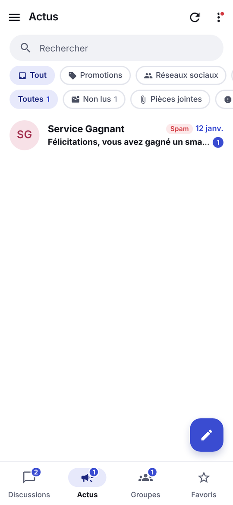
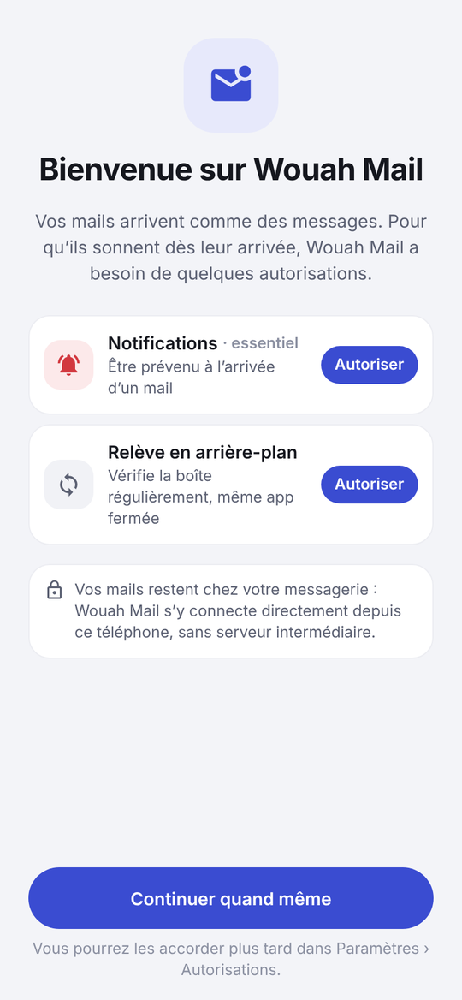
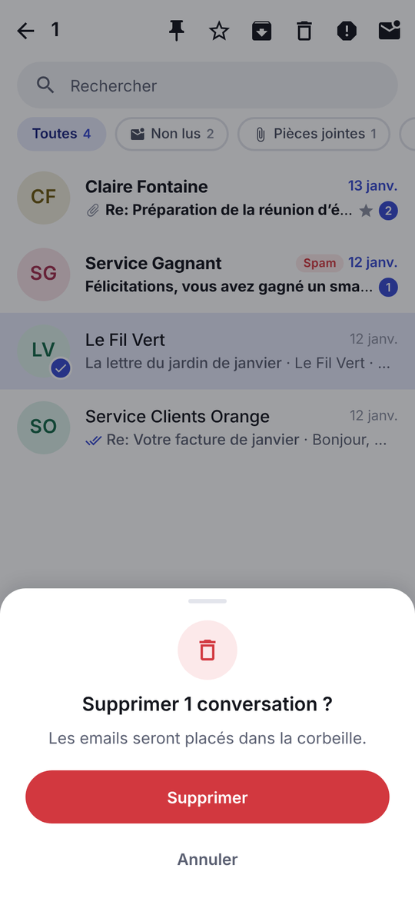
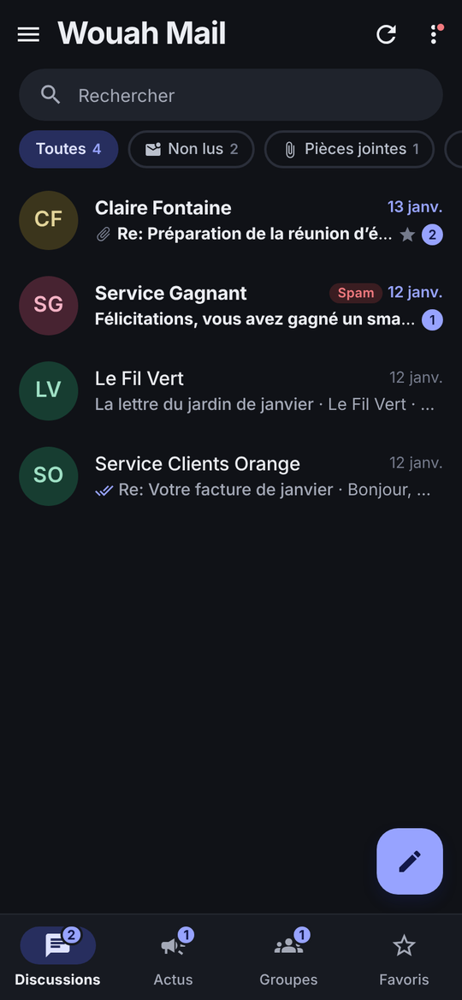
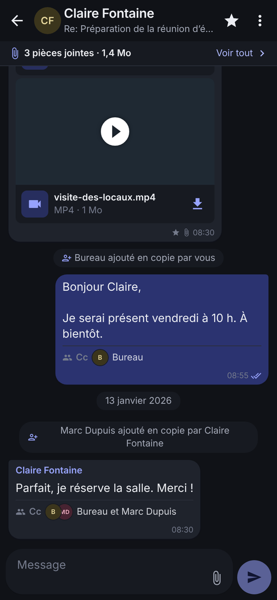

<p align="center">
  
</p>

<h1 align="center">Wouah Mail</h1>

<p align="center">
  <strong>Vos mails, aussi simples que vos messages.</strong><br />
  Un client mail Android qui range votre boîte en conversations, comme une messagerie instantanée.
</p>

<p align="center">
  <a href="https://wouah-mail.flamme.work">Site</a> ·
  <a href="https://wouah-mail.flamme.work/confidentialite.html">Confidentialité</a> ·
  <a href="https://wouah-mail.flamme.work/conditions.html">Conditions</a> ·
  <a href="CODE_OF_CONDUCT.md">Code de conduite</a>
</p>

---

Wouah Mail (aussi publiée sous le nom MailYo) se connecte **directement** depuis le
téléphone à votre messagerie, Gmail ou n'importe quelle adresse IMAP/SMTP. Il n'y a
**aucun serveur intermédiaire** : vos mails, contacts et identifiants restent sur
l'appareil et chez votre fournisseur.

## Captures d'écran

Données fictives du compte de démonstration.

<table>
  <tr>
    <td align="center"><br /><sub>Un fil par personne</sub></td>
    <td align="center"><br /><sub>Conversation en bulles</sub></td>
    <td align="center"><br /><sub>Catégories Gmail et dossiers</sub></td>
    <td align="center"><br /><sub>Newsletters et promotions à part</sub></td>
  </tr>
  <tr>
    <td align="center"><br /><sub>Autorisations expliquées au démarrage</sub></td>
    <td align="center"><br /><sub>Confirmations en bottom sheet</sub></td>
    <td align="center"><br /><sub>Thème sombre</sub></td>
    <td align="center"><br /><sub>Conversation en thème sombre</sub></td>
  </tr>
</table>

## Fonctionnalités

- **Conversations par personne** : bulles, citations, réponse en glissant, plusieurs sujets avec une même personne regroupés et choisis depuis une feuille.
- **Notifications instantanées** : connexion IMAP IDLE gardée par un service Android, sonnerie par expéditeur, toucher la notification ouvre la conversation.
- **Gmail complet** : catégories (Principale, Promotions, Réseaux sociaux, Notifications, Forums), favoris, envoyés, spam, archives et corbeille avec restauration.
- **Toute adresse IMAP** : Yahoo, iCloud, Orange, Free, SFR, La Poste, GMX, Zoho, OVHcloud, Fastmail et serveurs personnalisés.
- **Pièces jointes** : aperçu des images, PDF et vidéos dans le fil, galerie des fichiers échangés, enregistrement et partage.
- **Envoi maîtrisé** : annulation pendant quelques secondes grâce à un anneau de compte à rebours, brouillons, transfert propre.
- **Désabonnement en un appui** et onglet « Actus » pour les newsletters.
- **Vie privée** : images distantes bloquées (pixels espions), alerte sur les liens trompeurs, verrouillage biométrique.
- **Recherche plein texte** hors connexion (objet, expéditeur, contenu, noms de fichiers).
- **Thème clair et sombre**, avatars à initiales, confirmations en bottom sheet.

## Confidentialité

- L'application parle directement à Google (API Gmail) ou au serveur IMAP/SMTP de votre fournisseur.
- Les jetons Google et mots de passe IMAP sont chiffrés dans le stockage sécurisé d'Android.
- Aucun outil d'analyse, de publicité ou de suivi.
- Se déconnecter d'un compte révoque l'accès et efface ses données du téléphone.

Détails : [politique de confidentialité](https://wouah-mail.flamme.work/confidentialite.html) ([English](https://wouah-mail.flamme.work/privacy.html)).

## Tags

`android` `email-client` `gmail` `gmail-api` `imap` `smtp` `imap-idle` `react-native` `expo` `expo-router` `typescript` `sqlite` `messaging` `privacy` `offline-first`

## Stack technique

| Domaine        | Choix                                                                        |
| -------------- | ---------------------------------------------------------------------------- |
| Application    | Expo SDK 57, React Native, React 19, Expo Router, TypeScript                 |
| Stockage local | expo-sqlite (recherche FTS5), expo-secure-store                              |
| Gmail          | OAuth2 (expo-auth-session), API REST Gmail, API People pour les contacts     |
| IMAP / SMTP    | Module natif Kotlin (`modules/mailyo-imap`) basé sur JavaMail                |
| Temps réel     | Service Android au premier plan avec IMAP IDLE, relève périodique en secours |
| Notifications  | expo-notifications, sons embarqués, canal par sonnerie                       |
| Animations     | Reanimated, Gesture Handler                                                  |
| Tests          | Jest, Testing Library, SQLite en mémoire                                     |

## Démarrer

L'application dépend de modules natifs : elle ne tourne **pas** dans Expo Go. Il faut un
development build.

```bash
npm install
npx expo run:android          # compile et installe le development build
```

Sans SDK Android local, via EAS :

```bash
npx eas-cli@latest build --profile development --platform android
npx expo start --dev-client
```

Dans l'application, l'écran de connexion propose un **compte de démonstration** avec
des données fictives, pratique pour tout tester sans identifiants.

### Construire un APK dans un conteneur cloud

Voir [docs/build-android-cloud.md](docs/build-android-cloud.md) et
`scripts/build-android-cloud.sh`.

## Commandes utiles

```bash
npm run verify       # typecheck + lint + tests
npx tsc --noEmit     # typecheck
npx expo lint        # lint
npm test             # tests Jest
```

## Structure

```
src/
  app/            routes Expo Router (écrans)
  screens/        écrans partagés (liste des conversations, tiroir, autorisations)
  ui/             design system (thème, bottom sheets, bulles, lignes, avatars)
  state/          contexte applicatif, requêtes, autorisations
  services/       MailService, point d'entrée de la logique applicative
  domain/         logique métier pure et testée (fils, noms, citations, doublons)
  data/           SQLite, migrations, repositories
  providers/      Gmail, IMAP, compte de démonstration
  sync/           moteur de synchronisation et relève en arrière-plan
  realtime/       notifications instantanées (IMAP IDLE, emplacement relais)
  notifications/  règles de sonnerie et publication système
modules/mailyo-imap/   module natif Kotlin (IMAP, SMTP, service temps réel)
site/                  site vitrine et documents légaux (HTML/CSS, Dockerfile)
docs/                  documentation technique et captures
```

Les dossiers `android/` et `ios/` sont générés (Continuous Native Generation) et ne
sont pas versionnés : la configuration native vit dans `app.json`.

## Site web

Le dossier [`site/`](site/) contient la page d'accueil, les politiques de
confidentialité et les conditions d'utilisation, en français et en anglais. Il se
déploie avec le `Dockerfile` fourni (voir [site/README.md](site/README.md)).

## Contribuer

Les contributions sont les bienvenues :

1. Ouvrez une issue pour décrire le bug ou l'idée.
2. Créez une branche, puis lancez `npm run verify` avant de proposer une pull request.
3. Décrivez ce qui change et comment le vérifier.

En participant, vous acceptez de respecter le [code de conduite](CODE_OF_CONDUCT.md).

## Contact

Flamme WASSANGOU, [flammewassangou@gmail.com](mailto:flammewassangou@gmail.com)
